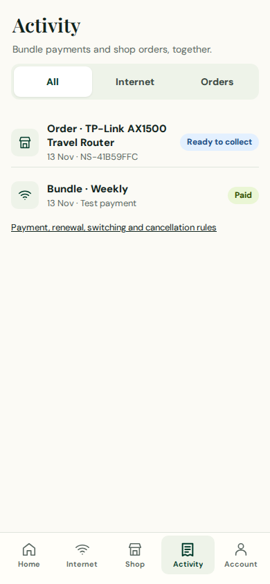
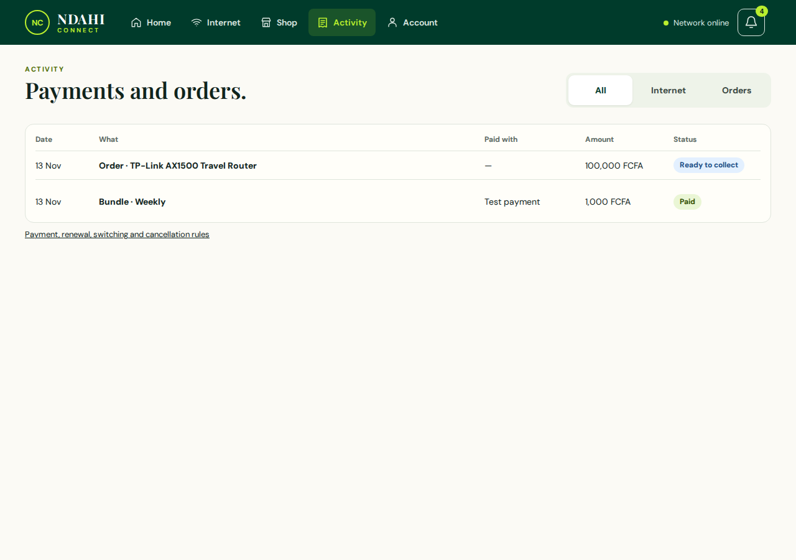
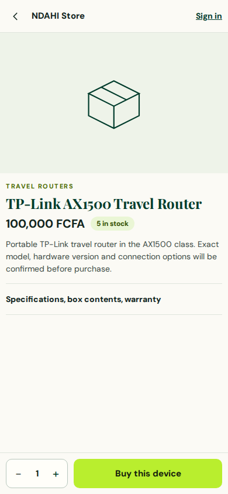
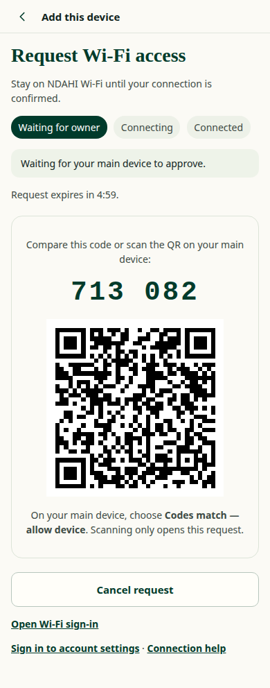
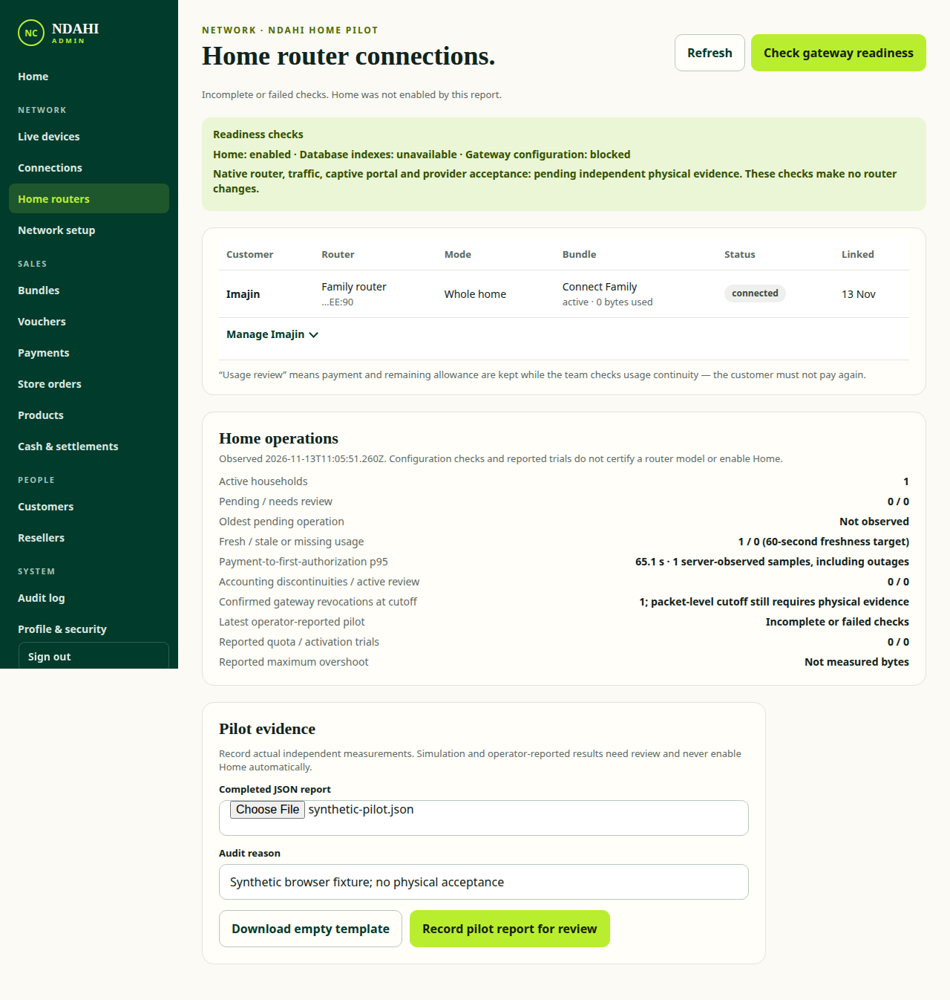

# Reviewed redesign integration — 13 November 2026

The owner authorized merging PRs that meet the redesign requirements and closing validated implementation issues. The governing reference is the 63 exported artboards in `docs/redesign/screens`. The later owner decisions require English and thermal-only 58/80 mm printing (58 mm default), even where older artwork differs.

## Reviewed changes and disposition

- Admin PR #226 merged into preview as `5dd837c5` after eight green checks, independent Claude Code review and fresh populated Home evidence. Role isolation (#235) and reseller hierarchy (#237) are included. Minor admin polish remains assigned to Claude in #232.
- Phase 6 PR #242 merged into customer as `208bd7dc` after ten green checks. Independent review and negative-case reproductions verified proof/action binding, post-retirement legacy-challenge rejection and browser CI wiring (#245).
- Customer PR #227 merged into preview as `012f4d99` after all ten checks passed on `bb0bd879`. Claude's Activity/store fixes and unavailable-order handling are included; Claude also fixed pairing-step contrast. Codex corrected a reproduced voucher-mode readiness race in the browser helper. Validated issues #231 and #233 are closed, with reciprocal PR/issue links.
- Parent #221 merged into the Home branch as `0765e342` after all ten checks passed on reviewed head `012f4d99`. Final #220 integrates this approved stack with current main, including the separately approved dependency upgrade #215. Neither parent's old incomplete head was accepted solely on historical CI.

## Verification

`bb0bd879` full preview inventory: **118 captured entries, four explicitly blocked default-preview states, zero failures**, with clean tracked source. The blocked records are retained honestly: Home enrollment disabled, pairing request disabled, missing pairing-review fixture and empty admin household table. Separate actual UI/API journeys with synthetic gateways and mock payments cover those four states at 390/1280. They do not establish physical or production acceptance.

The customer CI unit job passed **1,338 tests, zero failures and zero skips**. Local checks for the reviewed stack passed: 38 focused Phase 6 units, six virtual-authenticator journeys, 24 Home checks, nine matching journeys, notification journeys on both variants and the Activity browser fixture matrix. The new Activity regression covers interleaved dates, filters, preserved payment actions, order links, failed/empty history and phone/desktop overflow. Pairing asserts rendered text contrast.

A clean normal merge with main `f5b87ce9` installed the actual lockfile (Node 22, Playwright 1.65.0, SimpleWebAuthn 14.1.0, web-push 4.0.0) and passed `npm run check`, **1,297 tests with 41 skips**, six Phase 6 journeys and all three redesign browser regression tests. Independent installed Claude Code found no dependency-integration merge blocker. The final #220 head still requires all ten current checks before its main merge. Its normal merge with current main produced exactly the tested preflight tree `7af3c505`; this evidence commit adds documentation and screenshots only.

[Customer CI](https://github.com/ImaJin14/Ndahi-Connect/actions/runs/43415475896) and [parent integration CI](https://github.com/ImaJin14/Ndahi-Connect/actions/runs/43416953337) includes both full browser variants, unit verification, security scans and the added sign-in/role regression jobs. The independent visual review inspected 22 paired reference/build images and the supplementary states, rather than manually reviewing every captured pair. Other source and automated checks complement that sample.

## Accepted screenshots and findings

These are synthetic local fixtures captured in this audit, using current UI and real local API boundaries. Plans, prices, stock and order status come from fixture API data. The full-capture images use source `bb0bd879`; the populated Home supplement predates only the unrelated pairing CSS/test-helper changes. The dependency integration changes no frontend styles.

| Step | View and health | Evidence and limits |
| --- | --- | --- |
| 1 | Activity phone — functional | Payments and orders share one newest-first list. Filters, actions, order links and unavailable/empty states are browser-tested. |
| 2 | Activity desktop — functional, minor presentation differences | Desktop gutters match the reference. Payment actions remain in native expandable rows rather than a separate action column; order payment method is unavailable in the API and is shown honestly. |
| 3 | Guest product — corrected | Long phone category labels wrap; product hero is 240 px. The catalogue lacks a verified product photo, so the existing placeholder remains. No price, stock, model detail or pickup fact is invented. |
| 4 | Pairing request — corrected | The active progress label now renders white against forest and meets the browser contrast assertion. This fixture verifies the waiting UI and matching flow, not a physical router. |
| 5 | Populated admin Home — functional, P2 polish tracked | A masked household row, operations data and pilot-report controls render. Blocked/unavailable gateway facts and incomplete physical evidence stay explicit. Minor callout treatment and density refinements remain in #232. |

### 1. Activity, 390 px

### 2. Activity, 1280 px

### 3. Guest product, 390 px

### 4. Pairing request, 390 px

### 5. Populated admin Home, 1280 px

## Remaining release and workspace gates

V1 remains configured as default. No rollout percentage, Home enablement, authentication retirement, deployment command or real provider transaction is performed by this review. Home target migration/index/backup and the physical router/AP pilot remain in #178; release evidence in #143, store launch/legal acceptance in #192/#214 and physical printing in #116 remain open. Copilot's independent logger-test follow-up is #243. Screenshots and mock journeys do not establish full accessibility compliance or physical acceptance.

The owner's requested WISP software closures (#170/#171/#175/#177) link to merged #179/#184 and consolidate remaining live acceptance in #178. No newer production migration success is inferred from those closures.

Peer-owned checklist/source drafts and the original uncommitted admin #232 drafts were preserved. A current checklist entry is prepared for handoff rather than overwriting the other task's pending edits.
